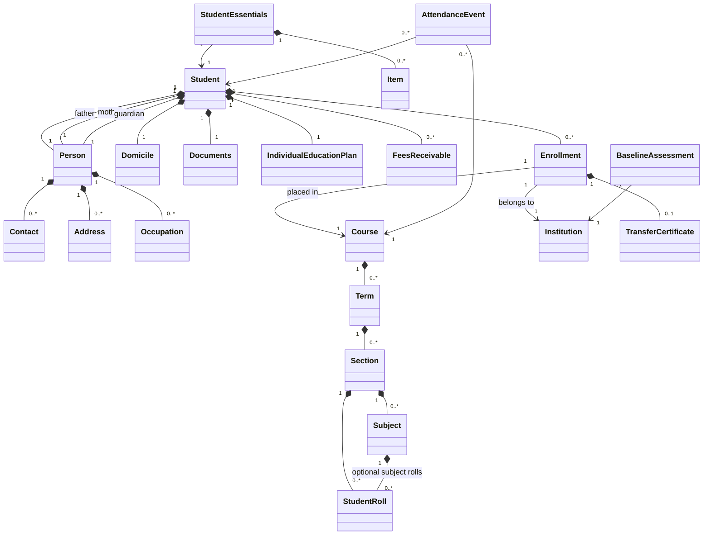
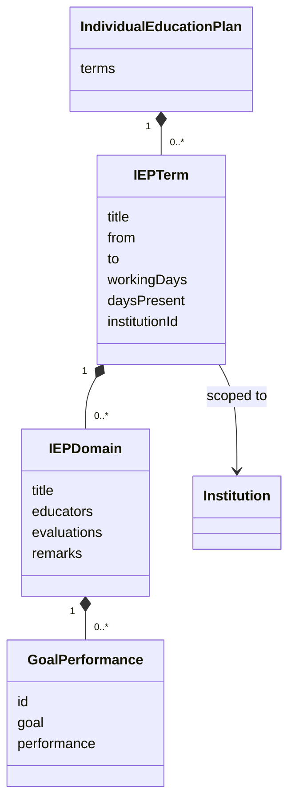
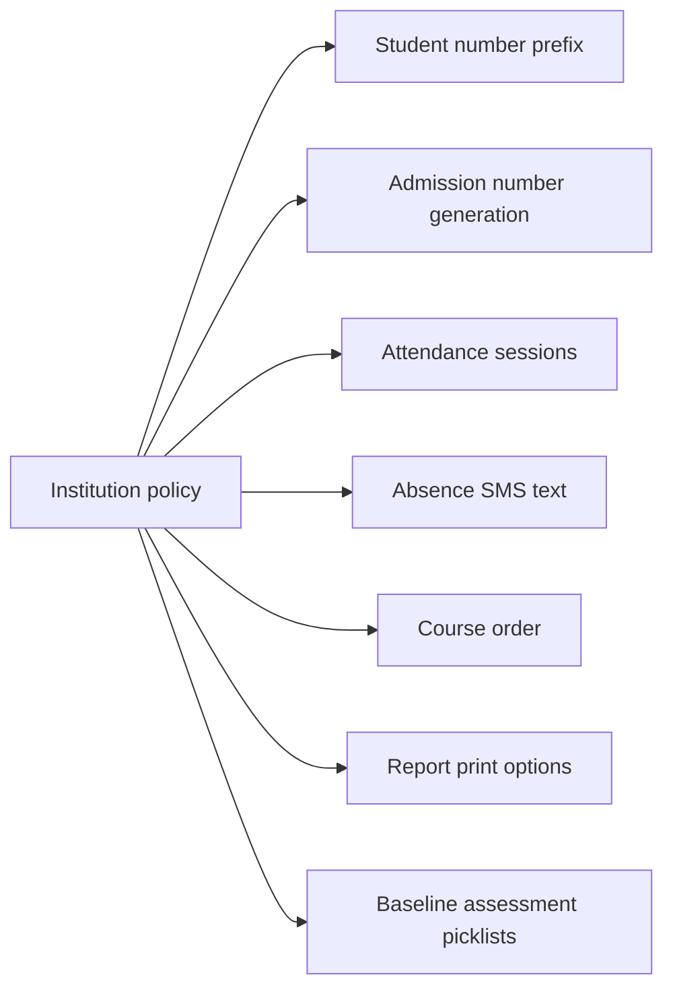
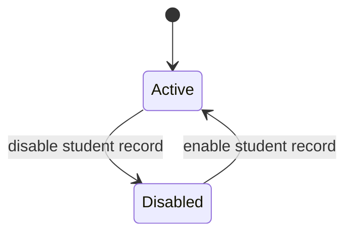
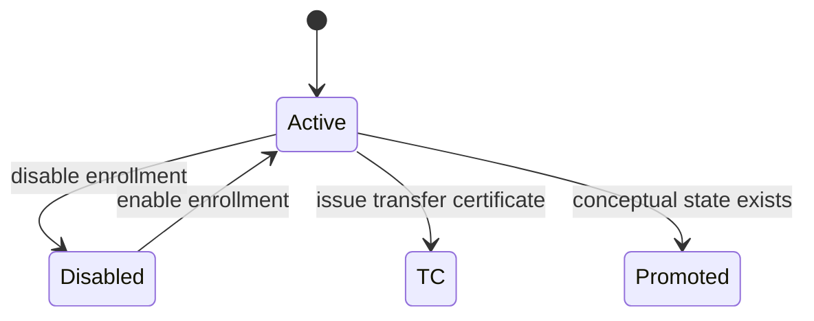
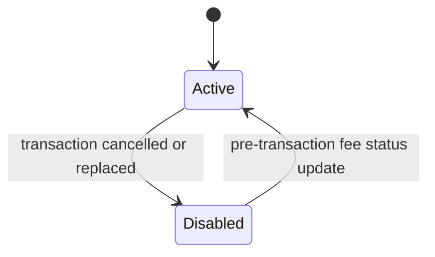
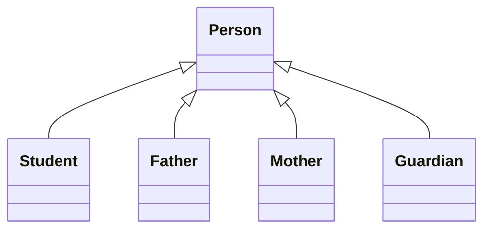
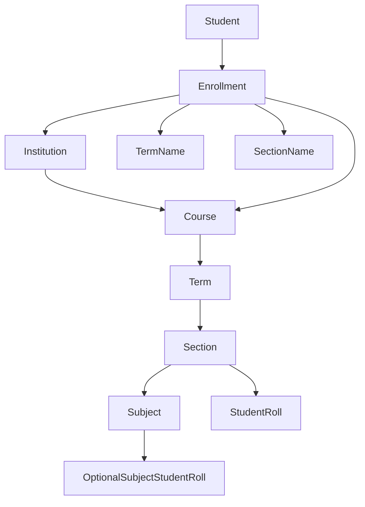
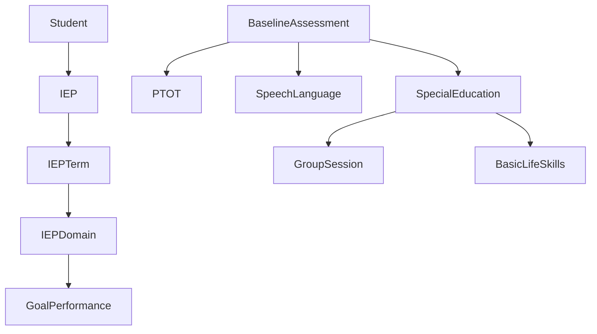

# Student Domain Ontology

This document describes the student service as a domain model: concepts, aggregates, value objects, relationships, hierarchies, constraints, and business rules.

## Bounded Context

The Student Service owns the institution-facing student record. Its domain spans:

- Student identity and lifecycle.
- Institution enrollment and course placement.
- Parent, guardian, address, and contact management.
- Student numbers, admission numbers, roll numbers, and transfer certificates.
- Fee receivable links from finance workflows.
- Attendance recipient lookup and absence messaging.
- Individual Education Plans and baseline assessment for special education workflows.
- Student essentials or issued-item tracking.
- Student-facing reports and recipient lists.

The service references institutions, academic years, courses, fees, transactions, staff, and users, but those are mostly external or adjacent domains. The student record stores identifiers for those concepts rather than owning their full lifecycle.

## Aggregate Roots

### Student

Student is the central aggregate root. It represents a learner across one or more institutions.

Owned concepts:

- Person identity: name, gender, date of birth, virtual identity, tags, attributes.
- Student-level identifiers: record id, Aadhar number, disability id, user id, photo path.
- Contacts and addresses for the student.
- Father, mother, and guardian as embedded person records.
- Domicile details.
- Enrollment list.
- Fee receivable list.
- Individual Education Plan.
- Document references.

Core invariants:

- A student starts active when created.
- A student always initializes father, mother, guardian, enrollments, contacts, domicile, fees, IEP, and documents.
- A student may have multiple enrollments, but at most one enrollment per institution.
- Student-level status and enrollment-level status are separate. Current lifecycle operations primarily change enrollment status.
- Re-enrolling a student in the same institution updates the existing enrollment instead of adding another one.

### Course

Course is an aggregate root for academic structure.

Owned concepts:

- Course identity, name, branch, affiliation, education level, status, rank, and display order.
- Terms.
- Sections.
- Subjects.
- Student roll assignments.
- Exam subject display order.

Core invariants:

- A course must have a non-empty name to be valid.
- Terms own sections.
- Sections own subjects and student rolls.
- A term cannot be updated, renamed, or removed unless it exists.
- A section cannot be added twice within the same term, using case-insensitive comparison.
- A subject cannot be added twice within the same section.
- Active student reporting depends mainly on enrollment data, while course structures provide sections, subjects, roll assignments, and sort order.

### Student Essentials

Student Essentials is a separate aggregate keyed to a student.

Owned concepts:

- Student id.
- Item list.

Core invariants:

- Each item receives an incrementing item number within the student's essentials record.
- Items are active by default.
- Items are disabled and re-enabled rather than deleted.

### Baseline Assessment

Baseline Assessment is a separate aggregate for assessment submissions.

Owned concepts:

- Child identity at time of observation.
- Date of birth, age at observation, gender, language, therapist, observation date.
- Consultation flags.
- Physical/occupational therapy observations.
- Speech/language observations.
- Special education observations.

Core invariants:

- A baseline record belongs to an institution owner.
- Baseline domains are structured into PT/OT, speech/language, and special education sections.
- Institution policy supplies many of the picklist values used by the assessment form.

### Attendance Event

Attendance Event is a record aggregate used for absence lookup.

Owned concepts:

- Institution, course, term, section, date, period, subject, optional-subject flag, student id, staff id, attendance value, and creation details.

Core invariants:

- Absentee workflows group attendance events by period/session and student.
- Attendance lookup is used to build absence recipient lists.

## Entity And Value Object Catalog

### Person

Person is the base concept for student, father, mother, and guardian.

Attributes:

- First name, middle name, last name, title, gender, date of birth.
- Primary email/mobile convenience fields.
- Contact list.
- Address list.
- Tags and arbitrary attributes.
- Occupations.
- PAN.
- Virtual identity.

Rules:

- A full name is sanitized by removing non-letter characters except apostrophes, collapsing whitespace, and title-casing name parts.
- The first token becomes first name, the last token becomes last name, and middle tokens become middle name.
- A generated virtual identity uses first name, last name, the first four characters of the record id, and the `campustrack.net` domain.
- Only virtual identities under `campustrack.net` are accepted when explicitly set.
- A valid mobile is a primary mobile contact with 10 characters.
- A valid email is a primary email contact that can be parsed as an email address.
- Setting a primary email or primary mobile replaces the existing primary contact of that type.
- Home address and home phone are single-current values; setting them removes prior home entries of that kind.

### Contact

Contact is a value object owned by a person.

Attributes:

- Contact type: email, mobile, phone, website, social, unknown.
- Location: personal, home, office, other, institute, unknown.
- Info value.
- Status: active, disabled, archived, unknown.
- Primary flag.
- Notes and archive date.

Rules:

- Contacts default to active, personal, non-primary, and empty info.
- Parent and guardian mobile/email contacts can be disabled without deletion.
- Student institute email is stored as an institute-located email contact.

### Address

Address is a value object owned by a person.

Attributes:

- Location, line 1, line 2, city, state, country, pincode, archive date, status.

Rules:

- Address status can be active, archived, or unknown.
- Home address is rendered as a comma-separated address string.

### Domicile

Domicile is a value object owned by a student.

Attributes:

- Caste, country, mother tongue, state.

Rules:

- Country defaults to India.

### Enrollment

Enrollment is an entity owned by Student. It represents one student's relationship with one institution.

Attributes:

- Institution id.
- Course id and course name.
- Term name.
- Section name.
- Branch.
- Roll number.
- Institution student number.
- Date of admission.
- Application number.
- Admission number.
- Optional subjects.
- Transfer certificate number, applied date, issued date, character, conduct, remarks, and attributes.
- Status.

Rules:

- Institution id is mandatory when assigning or enrolling in an institution.
- Course id and term name are mandatory for course placement.
- One student can have only one enrollment for a given institution.
- A real institution student number is distinct from the system student record id.
- If an enrollment student number is a GUID, it is treated as a placeholder and displayed as blank.
- Roll number is enrollment-specific, not student-wide.
- Transfer certificate details live on the enrollment, not on the top-level student.

### Transfer Certificate

Transfer Certificate is a value object concept embedded in Enrollment.

Attributes:

- Certificate number, applied date, issued date, character, conduct, remarks, and custom attributes.

Rules:

- Issuing a transfer certificate changes the enrollment status to TC.
- A transfer certificate requires an existing enrollment in the current institution.
- No explicit domain operation was found for reversing a transfer certificate.

### Fees Receivable

Fees Receivable is a value object owned by Student.

Attributes:

- Institution id, fee id, fee name, transaction id, transaction status, amount.

Rules:

- A fee receivable is unique by transaction id for normal fee updates.
- Adding an already-known transaction id does not add a duplicate.
- Replacing or cancelling a transaction disables the previous receivable and adds a new active receivable with an empty transaction id.
- Spanning fees are applied by institution and fee id before individual transactions exist.
- Spanning fees update amount and status when the institution/fee pair already exists.
- Transaction status can be active, disabled, or unknown.

### Opening Balance

Opening Balance is a fee-related concept.

Attributes:

- Institution id, fixed fee id, fixed fee name, amount.

Rules and uncertainty:

- It represents historical fees receivable at the beginning of a period.
- The reviewed behavior prepares an opening-balance value but does not clearly attach a new value to the student when missing. Treat this as unresolved.

### Documents

Documents is a value object owned by Student.

Attributes:

- Diagnosis report.
- Disability certificate.
- Birth certificate.
- Identification proof.
- Address proof.
- Therapy report.
- Psychological assessment report.

Rules and uncertainty:

- The student stores document references or paths, not the document content itself.
- Disability report handling appears inconsistent because the operation reviewed writes to the diagnosis report reference rather than the disability certificate reference.

### Individual Education Plan

Individual Education Plan is a value object owned by Student.

Hierarchy:

- Individual Education Plan
  - IEP Term
    - Domain
      - Goal Performance

Term attributes:

- Title, from date, to date, working days, days present, institution id.

Domain attributes:

- Title, educators, goals/performance list, evaluations, remarks.

Goal Performance attributes:

- Local id, goal text, performance number.

Rules:

- Saving an IEP replaces the student's term list.
- Each saved term is stamped with the current institution id.
- Blank goals are discarded.
- Goal performance items are renumbered from 1 within each domain.
- Goal text is mandatory when adding a goal performance item.

### Student Essentials Item

Student Essentials Item is an entity within Student Essentials.

Attributes:

- Local item id, name, date, amount, institution id, status.

Rules:

- Item ids are sequential per essentials record.
- Items default active.
- Disabled items remain in the record and can be enabled.

### Baseline Assessment Components

Baseline PT/OT tracks:

- Condition, speech, response to name call, focus/attention, eye contact, sitting tolerance, instruction following, body build, posture, muscle tone, muscle tightness, grasp, precision, proprioception, static balance, dynamic balance, coordination, gait, sensory profile, and behavior.

Baseline Speech/Language tracks:

- Activity/topic focus, speech, condition, eye contact, sitting tolerance, activity compliance, receptive language, expressive language, social communication, pragmatics, intelligibility, behavior, literacy, and recommendation.

Baseline Special Education tracks:

- Condition, speech, focus/attention, eye contact, sitting tolerance, instructions comprehension, activity compliance, behavior, barriers to learning, writing, literacy, number concept, conversational communication, cognition, environmental studies, group-session behavior, basic life skills, and additional comments.

Supporting value objects:

- Baseline item: id and name.
- Group session observations: appearance, group sitting behavior, observed behavior, following instructions, waiting turn, participation.
- Basic life skills: eating habits, toilet training, knowing belongings, dressing skills.

Rules:

- Baseline picklists are institution-policy controlled.
- Some institutions use empty baseline picklists; AKSHFN and BTLCOL include detailed special-needs lists.

## Concept Relationships

## State Models

### Student Status

Student status exists, but the primary current workflows enable and disable the institution enrollment rather than the top-level student record.

### Enrollment Status

Notes:

- Active enrollments are current institutional memberships.
- Disabled enrollments remain attached to the student but are not current.
- TC enrollments represent transferred-out students.
- Promoted exists as a state, but the reviewed promotion flow adds a target enrollment and does not clearly mark the base enrollment as promoted.

### Fee Receivable Status

## Relationship Rules And Cardinalities

| Source concept | Relationship | Target concept | Cardinality | Rule |
|---|---|---|---:|---|
| Student | owns | Enrollment | 0..many | One per institution; duplicate institution enrollment is updated, not duplicated. |
| Enrollment | refers to | Institution | 1 | Institution id is mandatory for enrollment. |
| Enrollment | refers to | Course | 1 | Course id and term name are mandatory for course placement. |
| Enrollment | contains | Transfer Certificate | 0..1 | Present when TC details are issued. |
| Student | embeds | Father, Mother, Guardian | 1 each | Each is a person record initialized with the student. |
| Person | owns | Contact | 0..many | Primary email/mobile is replaced when reset. |
| Person | owns | Address | 0..many | Only one current home address is kept by setter behavior. |
| Student | owns | Fee Receivable | 0..many | Normal uniqueness is by transaction id; spanning fees match institution and fee. |
| Student | owns | IEP | 1 | Saved IEP terms replace existing terms. |
| IEP Term | owns | Domain | 0..many | Term is institution-scoped. |
| Domain | owns | Goal Performance | 0..many | Blank goals are removed and ids are renumbered. |
| Course | owns | Term | 0..many | Term name must exist before term updates or section operations. |
| Term | owns | Section | 0..many | Section names cannot duplicate in a term. |
| Section | owns | Subject | 0..many | Subject names cannot duplicate in a section. |
| Section | owns | Student Roll | 0..many | Student roll contains student id and roll number. |
| Subject | owns | Student Roll | 0..many | Used for optional-subject enrollment. |
| Student Essentials | refers to | Student | 1 | Separate aggregate found by student id. |
| Student Essentials | owns | Item | 0..many | Item ids increment locally. |
| Attendance Event | refers to | Student | 1 | Used for absence recipient lookup. |
| Attendance Event | refers to | Course | 1 | Attendance is course/term/section/period scoped. |

## Hierarchies

### Person Hierarchy

Student inherits person properties and also embeds three additional person records for family/guardian relationships.

### Academic Structure

Important modeling note: course structure and student enrollment both carry placement information. The enrollment is the primary student-centric placement record; course section rolls are a course-centric roster model.

### Special Education Structure

## Business Rules

### Identity Rules

- Student record id is the durable learner record identifier.
- Institution student number is stored on enrollment and is institution-specific.
- A GUID stored as an enrollment student number is treated as a placeholder and shown as blank.
- If no student number is supplied, the number is generated from academic year, institution-specific course prefix, and a three-digit sequence.
- Admission number can be manually supplied.
- For institutions that auto-generate admission numbers, the number uses the institution policy prefix and a four-digit sequence.
- Student virtual identity is derived from name and record id unless explicitly set to an accepted `campustrack.net` identity.

### Enrollment And Placement Rules

- One student can be attached to many institutions over time.
- Only one enrollment may exist for a student in a given institution.
- Institution id is required to create or assign enrollment.
- Course id and term name are required for course placement.
- Section and branch are optional.
- Roll number, date of admission, application number, and admission number belong to enrollment.
- Updating course placement changes the enrollment for the current institution.
- Promotion clones the base enrollment into the target institution/course and removes any existing target-institution enrollment first.
- Term and section carry forward during promotion unless target values are supplied.

### Lifecycle Rules

- New students are active.
- New enrollments are active.
- Enabling/disabling in normal workflows acts on the current institution enrollment.
- Transfer certificate issuance changes enrollment state to TC.
- Current-student lists generally filter for active enrollment state.
- TC-student reports intentionally filter for TC enrollment state.

### Contact Rules

- Student, father, mother, and guardian can all hold contacts.
- Parent recipient lists use father, mother, and guardian contacts.
- Student recipient lists may include student personal and institute contacts.
- Primary email/mobile replacement removes previous primary contact of that type.
- Disabled contacts remain present but should not be treated as active.
- Mobile validity requires a 10-character primary mobile.
- Email validity requires a parseable primary email.

### Finance Rules

- Fee receivables are student-owned references to institution fee/transaction information.
- Duplicate transaction ids are not added twice.
- A replaced transaction disables the old receivable and creates a new active pending receivable.
- Spanning fees can be assigned before transaction creation and use empty transaction id.
- Opening balance exists as a concept but its creation behavior is unresolved.

### Special Education Rules

- A student has one IEP object containing multiple terms.
- Saving an IEP replaces the full term list.
- IEP terms are scoped to the current institution.
- Goals with empty text are removed.
- Goal performance ids are local sequential ids within a domain.
- Baseline assessment forms are institution-sensitive through policy-driven picklists.

### Essentials Rules

- Student essentials are separate from the student aggregate and found by student id.
- Each item has name, date, amount, institution, and status.
- Items are disabled rather than physically removed.

### Reporting And Query Rules

- Active student reports rely on both active student records and active enrollment states depending on report.
- Coursewise and institution counts count active enrollments.
- Search supports student number, student name, father name, and mother name.
- Parent-bound lookup can filter students by parent email.
- Course-section search accepts course/section pairs and resolves course names to course ids.
- Default ordering is course sort order, branch, section, roll number, then name.

## Institution Policy Ontology

Policy is an institution-specific rule source, not a student-owned object.

Policy-controlled concepts:

- Attendance sessions per day.
- SMS gateway.
- Absence message text.
- Course-prefix mapping for student number generation.
- Course ordering.
- Print pagination.
- Admission number auto-generation.
- Admission number prefix.
- Baseline assessment picklists.

Known policy differences:

| Institution | Distinctive rules |
|---|---|
| AKSHFN | Two attendance sessions, auto-generated admission numbers with AK academic-year prefix, detailed baseline picklists. |
| BTLCOL | Eight attendance sessions, detailed baseline picklists. |
| VVSGCS | Custom course-prefix mapping for Playhome through VII and 10 records per printed page. |
| VVSPHS | Custom course-prefix mapping for 8th, 9th, Xth and high-school course order. |
| VVSPUC | Two attendance sessions and PUC I/PUC II course order. |
| VVSSPU | Two attendance sessions and PUC I/PUC II course order. |
| BITLOK | Mostly default behavior with some special-education picklists. |
| PPECKN | Default-like behavior. |

## External Concepts Referenced By Identifier

These concepts are referenced but not owned by the student aggregate:

- Institution.
- Academic year/client configuration.
- Course, when referenced from enrollment.
- Fee and fee transaction.
- Staff, in attendance events.
- User account, through student user id and virtual identity.
- Messaging jobs and recipient delivery.
- Report templates and generated documents.

## Modeling Risks And Unresolved Points

- Student status and enrollment status overlap. Current workflows mostly mutate enrollment status, so domain users should treat enrollment state as the main lifecycle state for institution membership.
- Promotion has a conceptual promoted state, but the reviewed promotion flow does not clearly mark the base enrollment as promoted.
- Course rosters and student enrollments duplicate placement information. Reconciliation rules are not fully explicit.
- Opening balance is modeled but its add behavior appears incomplete.
- Disability certificate/reference storage appears inconsistent with the disability-report update operation.
- Parental contact validity appears to depend on mother or guardian validity and may ignore father validity in one reviewed rule.
- Many behaviors are supported by operational scripts rather than assertion-heavy tests; edge-case rejection rules are not always explicit.
